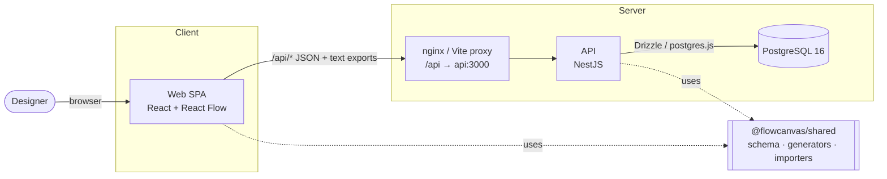
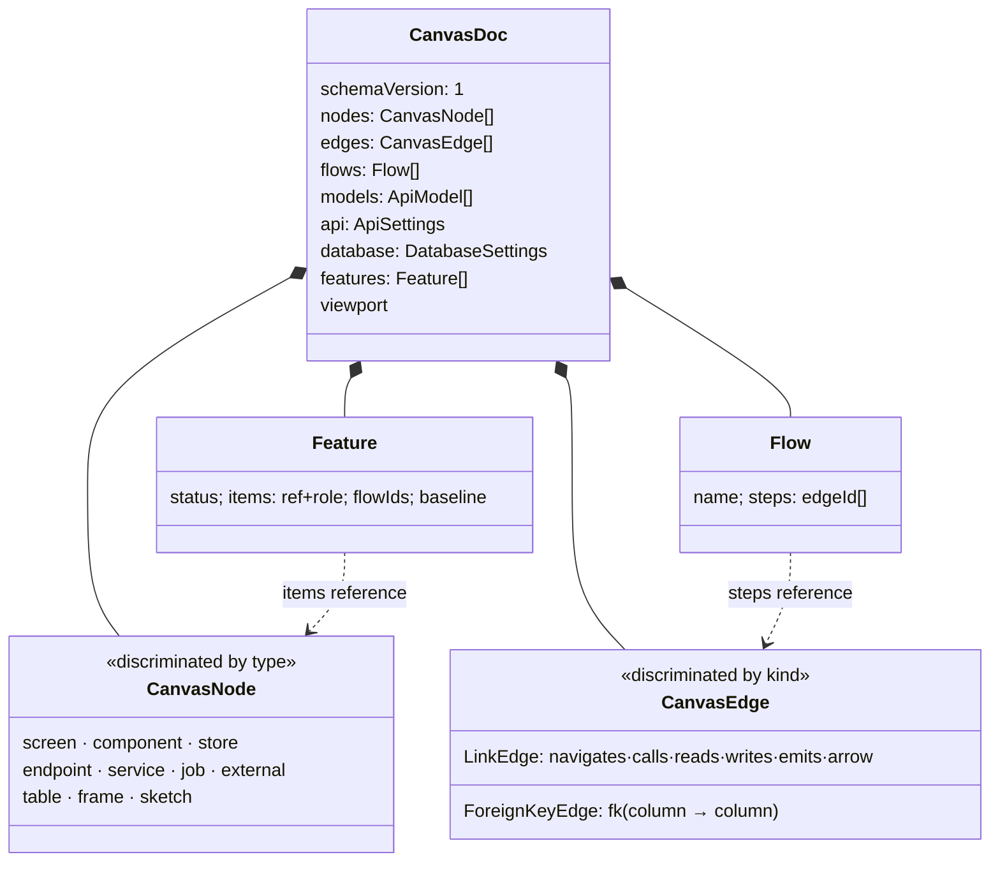
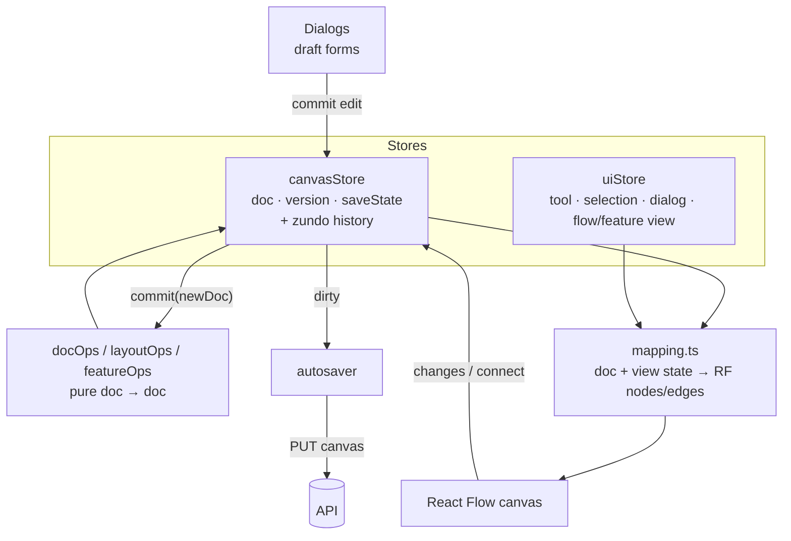
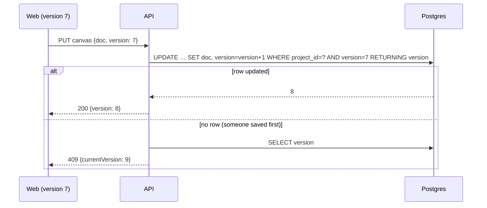

# RuneArch — Design & Architecture

Status: describes the code as of v0.0.1. Section numbers are stable: source comments cite them
(e.g. `ARCHITECTURE.md §8.5`), so add new sections rather than renumbering.

---

## 1. Overview

RuneArch is a canvas for designing a software system end to end: frontend screens and components,
backend endpoints, services and jobs, and database tables, all on one board and connected to each
other. Unlike a drawing tool, every box is typed data with a schema, so the board is also a
**specification** that generates working artifacts:

| From the canvas | You get |
| --- | --- |
| Endpoints + API models | OpenAPI 3 (JSON/YAML), FastAPI app, Pydantic and Zod schemas |
| Tables + FK edges | SQL DDL (PostgreSQL, MySQL, MariaDB, SQLite), DBML, Mermaid ER, SQLAlchemy, SQLModel, Drizzle, Prisma |
| Screens + wireframes | Screen specs (Markdown/JSON), wireframe SVGs |
| The whole board | SVG image, Mermaid flowchart, RuneArch JSON file |
| A feature | Brief (MD/JSON), task list, up/down SQL migration |

It also imports: OpenAPI specs, SQL DDL, DBML, and RuneArch JSON files.

## 2. Design goals and principles

**Goals**
- *One model, many views.* The same document drives the canvas, the dialogs, every export and every import.
- *Always exportable.* If the document is valid, every generator produces valid output. Validation happens
  while editing, not at export time.
- *Never lose work.* Autosave, undo, conflict detection, named checkpoints, and restore-that-checkpoints-first.
- *Plan change, not just state.* Features scope a piece of work over the board (what it adds, changes,
  removes) and can be shipped or discarded as a unit.

**Non-goals (for now)**
- Real-time multi-user co-editing. Concurrency is handled with optimistic locking (§8.4), not CRDTs.
- Round-tripping generated code back into the canvas. Generation is one way; import is from specs/DDL.
- Real authentication (§5.3 describes the stub).

**Principles that shape the code**
1. **Document-centric.** A project's design is one JSON `CanvasDoc`, saved whole.
2. **Schema is the contract.** A single Zod schema (`packages/shared/src/canvas.ts`) defines shape *and*
   integrity rules, and runs in the browser and on the server.
3. **Pure core, thin shells.** All domain logic (validation, transforms, generators, importers, diffing)
   is pure TypeScript in `packages/shared`. The API and web app are adapters around it.
4. **Registries over branching.** Export formats are table entries consumed generically by both UI and API.

## 3. System context and deployment



| Environment | How it runs |
| --- | --- |
| Local dev | `docker compose up -d` (Postgres only) + `pnpm dev`: Vite on :5173 proxies `/api` to Nest on :3000. |
| Containers | `docker compose --profile app up`: API image runs migrations + seed, then `node dist/main.js`; web image is static files on nginx (:8080) proxying `/api/` to the API. |
| CI | GitHub Actions with a Postgres service: `typecheck`, `lint`, `test`. |
| E2E | Playwright starts its own API (:3100) on a fresh `<db>_e2e` database and its own Vite (:5174). |

The browser always talks to a same-origin `/api`, so there's no CORS configuration.

## 4. Repository structure

```
packages/shared/   domain core (pure TS, built to ESM+CJS with tsdown)
  src/canvas.ts        CanvasDoc schema + integrity rules            (§5.1, §9)
  src/http.ts          REST contract                                 (§6)
  src/api.ts           endpoint spec, API models, field types
  src/wireframe*.ts    wireframe model + SVG                         (§9)
  src/feature*.ts      feature scopes: diff, changes, scope, lifecycle, migration, brief (§9)
  src/openapi*.ts      OpenAPI export / import
  src/sql*.ts, schema-*.ts, dbml-import.ts, database.ts   SQL dialects, schema export / import
  src/codegen/         code generators + registry
  src/canvas-*.ts, screen-export.ts, zip.ts                 other exports
apps/api/          NestJS REST API
  src/db/              Drizzle schema, migrations, seed
  src/auth/            dev auth stub (global guard)
  src/projects/        projects CRUD + ProjectAccessGuard
  src/canvas/          canvas load/save, snapshots
  src/*-export/        one thin controller per export family
  test/                API e2e specs (supertest, real Postgres)
apps/web/          React SPA
  src/store/           canvasStore (doc + undo), uiStore, pure doc ops, autosaver
  src/canvas/          React Flow wiring: mapping, nodes, edges, connect rules, views
  src/dialogs/         node/edge editors (draft forms) + wireframe editor
  src/features/ flows/ history/ spec/ api-design/ panels/   feature areas
e2e/               Playwright tests
```

Dependency direction is strictly `web → shared ← api`. Shared never imports from either app.

## 5. Data model

### 5.1 The canvas document



- **Nodes** share a base (`id`, `position`, optional `size`, `parentId`, `label`, `color`, `notes`) and a
  type-specific `data`. Lanes: frontend (`screen`, `component`, `store`), backend (`endpoint`, `service`,
  `job`, `external`), database (`table`), layout (`frame`, `sketch`).
- **Edges** are either behavioural links (with optional CRUD ops when one end is a table) or
  column-to-column foreign keys. Columns have stable ids so renames don't break FKs.
- **Flows** are ordered edge paths ("checkout"), each step continuing from a node already reached.
- **Models** are reusable API schemas (DTOs) referenced by endpoints and bound wireframe elements.
- **Features** — see §9.

New fields always get Zod `.default()`s, so documents saved earlier keep parsing. `schemaVersion` is the
hook for future breaking migrations; only version 1 exists.

### 5.2 Integrity rules

`CanvasDoc.superRefine` enforces cross-object rules that a per-field schema can't, including:
unique node/edge ids; parents are frames and frames don't nest; edges reference existing nodes, and only
interactive wireframe elements may start one; CRUD edges touch a table; FKs connect real columns of two
tables; table names unique per schema and column names unique per table (case-insensitive); indexes on
existing columns; flow steps valid and continuous; unique model and field names, resolvable model refs;
unique routes (also modulo param renames) and operationIds; declared path params match the path; feature
items exist, an item is `added` by at most one feature, baselines only for `changed` items.

These rules are what make principle "always exportable" hold: the OpenAPI and SQL generators assume them.

### 5.3 Relational storage

```mermaid
erDiagram
  users ||--o{ projects : owns
  users ||--o{ project_members : ""
  projects ||--o{ project_members : ""
  projects ||--|| canvas_documents : "live doc"
  projects ||--o{ canvas_snapshots : checkpoints
  users |o--o{ canvas_snapshots : created_by
  project_members { uuid project_id PK; uuid user_id PK; member_role role }
  canvas_documents { uuid project_id PK; jsonb doc; int version; timestamptz updated_at }
  canvas_snapshots { uuid id PK; uuid project_id; jsonb doc; text label; timestamptz created_at }
```

The design document lives in a single `jsonb` column. Postgres stores projects, membership and history;
it doesn't model canvas internals. This keeps saves atomic and the schema stable as the canvas evolves,
at the cost of not querying inside docs (not needed today).

**Authorization.** Roles are `viewer < editor < owner`. `ProjectAccessGuard` resolves the caller's
membership for `:id`; non-members and malformed ids get 404. Writes require `editor`; delete requires
`owner`. **Authentication** is a stub: `DevAuthGuard` (global) attaches the seeded dev user to every
request. It's registered via `useExisting` so tests can swap it, and real auth is meant to replace only
this guard.

## 6. REST API

All routes are under `/api`. Shapes are Zod schemas in `packages/shared/src/http.ts`, used by the API to
validate requests and by the web client to parse responses.

| Method & path | Role | Purpose |
| --- | --- | --- |
| `GET /health` | public | Liveness |
| `GET /projects` · `POST /projects` | — | List mine · create (creator becomes owner, empty canvas) |
| `GET/PATCH/DELETE /projects/:id` | viewer/editor/owner | Read · rename · delete |
| `GET /projects/:id/canvas` | viewer | `{ doc, version }` |
| `PUT /projects/:id/canvas` | editor | `{ doc, version }` → `200 { version }` or `409 { currentVersion }` |
| `GET/POST /projects/:id/snapshots` | viewer/editor | List (newest 200) · checkpoint current doc |
| `GET/DELETE /projects/:id/snapshots/:sid` | viewer/editor | Read with doc · delete |
| `POST /projects/:id/snapshots/:sid/restore` | editor | Restore (§8.8) |
| `GET /projects/:id/openapi.{json,yaml}` | viewer | Live OpenAPI (§8.6) |
| `GET /projects/:id/schema.{sql,dbml,mmd}` | viewer | Database schema |
| `GET /projects/:id/code/:target` | viewer | `pydantic`, `sqlalchemy`, `sqlmodel`, `fastapi`, `zod`, `drizzle`, `prisma` (+ zip packages) |
| `GET /projects/:id/screens.{md,json}` · `screens/:screenId/wireframe.svg` | viewer | Screen specs, wireframe image |
| `GET /projects/:id/canvas.{svg,mmd,json}` | viewer | Whole-board export (`?theme`, `?flow`) |
| `GET /projects/:id/features/:featureId/:file` | viewer | `brief.md`, `brief.json`, `tasks.md`, `migration.{up,down}.sql` |

Most exports accept `?feature=<id>` (one feature's slice, annotated by role) and `?unshipped=exclude`
(project without what unshipped features add); see `apps/api/src/common/export-scope.ts`.

**Errors.** `HttpExceptionFilter`: `ZodError → 400 { issues: [{ path, message }] }`; `HttpException →`
its status/body; anything else → logged `500` without internals. Request bodies are limited to 5 MB.

## 7. Web application



**State.** Two Zustand stores:
- `canvasStore` owns the `doc` (the only source of truth), its server `version`, save state, and
  transient view state that is never saved or undone (`measured`, `dragPositions`, `resizeSizes`,
  live `viewport`, `activeFeatureId`). Every mutation goes through `commit(newDoc)`: one call is one undo
  step (zundo, history partialized to `doc`, limit 200). When a feature is active, `commit` runs
  `tagChanges` so new items become `added` and edited ones `changed` (with a baseline copy) in the same step.
- `uiStore` holds UI-only state: tool, selection, open dialog, right panel, highlighted flow/feature,
  recording/playhead, hints.

**Visual design.** Frontend colors and typography are defined in
[`apps/web/src/theme/tokens.css`](apps/web/src/theme/tokens.css), then exposed to Tailwind and React
Flow by `global.css`. See [`docs/design.md`](docs/design.md) for the palette and usage guidance.

TanStack Query is used for the projects list and metadata; the canvas itself bypasses it and loads
straight into `canvasStore` (§8.1).

**Rendering.** `canvas/mapping.ts` rebuilds React Flow nodes and edges from the doc plus view state
(selection, flow highlight, feature roles, drag positions). React Flow never owns data; its change events
are translated back into store actions (`applyNodeChanges` keeps drags transient and commits once on
drop, so a drag is one undo step).

**Connect rules.** `canvas/connectRules.ts` decides what a new connection means from its endpoints:
screen→screen `navigates`, column→column `fk`, endpoint→table `reads`/`writes`, anything with a sketch is
an `arrow`, frames can't be connected, and so on. Rejections show a hint explaining why.

**Dialog drafts.** Node editors use `useDraftForm`: React Hook Form holds the draft, and on every change
the draft is applied to a *copy* of the whole doc and validated with the real `CanvasDoc` schema, so
cross-object errors (a duplicate route, an FK to a deleted column) show on the right field before saving.
Errors appear once a field is touched or a save is attempted. Saving commits one undo step.

**Shortcuts.** `hooks/useShortcuts.ts` handles global keys (undo/redo, delete, duplicate, tools, etc.)
inside the `ReactFlowProvider`.

**Autosave.** `store/autosaver.ts`: when the doc becomes dirty, wait 1.5 s after the last change, then
`PUT` the doc (with the live viewport merged in). One request in flight at a time; if the doc changed
during the request, it stays dirty and saves again. `409` pauses saving (§8.5); `400` marks the named
nodes invalid; network errors retry with backoff (2 s doubling, max 30 s). `saveNow()` lets checkpoints
and restores wait for pending edits. On page hide, a best-effort `keepalive` save is attempted for docs
under ~60 KB, and `beforeunload` warns when anything is unsaved.

## 8. Key flows

### 8.1 Opening a project
`CanvasPage` fetches `GET /canvas` once per project id, parses it with `CanvasResponse`, calls
`canvasStore.load(doc, version, projectId)` (which clears undo history and resets save state) and resets
`uiStore`. Only then does the editor mount and autosave start. 404 shows "does not exist or you have no access".

### 8.2 Editing
User action → store action → pure op (`docOps.*`) returns a new doc → `commit` (optionally feature-tagged)
→ zundo records a step → the store subscription marks `saveState: 'dirty'` → React Flow re-renders from the
mapping. Undo/redo just swap `doc`, which also marks dirty, so undo is saved too.

### 8.3 Validation
The same `CanvasDoc` schema runs (a) live in dialogs against a draft copy, (b) on import, and (c) in the
API pipe on every save. The server is authoritative; the client checks exist for fast feedback. A `400`
carries issue paths like `['doc','nodes',3,…]` which the autosaver maps to node ids to highlight.

### 8.4 Optimistic locking

The compare-and-set is a single conditional `UPDATE` in a transaction, which also bumps
`projects.updated_at`.

### 8.5 Save conflicts and failures
`SaveBanner` surfaces non-happy save states:
- **Conflict (409):** saving pauses; local edits are kept and can continue. The user chooses **Reload
  latest** (discard local, load server doc) or **Overwrite with mine** (adopt the server's current version
  number and save the local doc over it). There is no merge.
- **Invalid (400):** first issue message, count of others, offending nodes highlighted. Saving resumes on
  the next edit.
- **Network:** "changes are kept here" while the autosaver retries with backoff.

### 8.6 Live OpenAPI
`toOpenApi` (shared) turns endpoint nodes, models and `api` settings into an OpenAPI 3 document. The web
app's Spec dialog renders it live from the in-memory doc; `GET /openapi.{json,yaml}` renders it from the
saved doc, so the URL can be fed to other tools. With `?feature=` each operation is marked with
`x-feature-status`; `&only=changes` limits it to what the feature adds, changes or removes. An
`OpenApiExportError` (only possible for docs saved under older rules) maps to 422.

### 8.7 Other exports and imports
Every export family is a registry entry: `{ label, extension | file, mimeType, render(doc, options) }`.
The web export dialogs list entries and call `render` in the browser; the API controllers look the entry
up by URL segment (404 if unknown), load the saved doc, apply the export scope and call the same `render`.
Imports (`parseOpenApi`, SQL/DBML schema import, `parseCanvasFile`) produce a candidate doc or a merge
into the current one, which goes through `canvasStore.applyImport` → `CanvasDoc.parse` → one undo step.

### 8.8 Snapshots (checkpoints)
A checkpoint copies the **saved** doc into `canvas_snapshots` with an optional label (the web app calls
`saveNow()` first so it captures what the user sees). Restore runs in one transaction: lock the canvas row
(`SELECT … FOR UPDATE`), insert a checkpoint of the current doc labelled "Before restoring …", parse the
snapshot doc with today's schema (applying new defaults), write it as a new version. Nothing is ever lost:
a restore can itself be undone by restoring the auto-created checkpoint. The list shows the newest 200.

## 9. Domain concepts in depth

**Wireframes.** Screens and components can carry a low-fidelity wireframe: elements on a 12-column grid
(rows of 8 design px) with device frames (desktop 800, tablet 560, mobile 320). Elements have stable ids
so edges and flows can start from an interactive element (button, link, form, list); the edge's
`sourceHandle` encodes the element id. Components are reusable wireframes placed on screens as
`instance` elements (no nesting). Elements can be bound to an API model to generate a form, list or table;
the wireframe editor can scaffold a screen from an endpoint.

**Flows.** Named, coloured, ordered paths over edges, recorded by clicking edges in recording mode and
played back step by step with the playhead. Removing an edge prunes steps that no longer continue.

**Features.** A feature is a scope over the board for one piece of work:
- `items` reference nodes, edges or models with a role: `uses` (context), `added`, `changed`, `removed`.
- `changed` items keep a `baseline` copy taken on first edit, enabling per-field diffs (`feature-diff.ts`),
  reverting single changes or the whole item, and generating migrations (`feature-migration.ts`).
- Status `draft → in-progress → shipped`. **Ship** deletes what it removes and makes its work the plain
  project. **Discard** deletes what it adds and restores baselines. Both are one undo step and return
  warnings instead of failing.
- Conflicts and gaps between features are *warnings* (`feature-changes.ts`), never validation errors.
- Exports can be scoped to a feature (`feature-scope.ts`): its items plus the context they need, annotated
  by role. The brief/tasks/migration exports are the hand-off for implementing it.

Frames, sketches and plain arrows are layout and notes, never tagged into features.

**SQL dialects.** `database.dialect` (PostgreSQL, MySQL, MariaDB, SQLite) drives type suggestions, the
default SQL export and code generators. Switching dialect converts column types and defaults across the
doc in one untagged undo step.

## 10. Testing strategy

| Layer | Where | What |
| --- | --- | --- |
| Domain | `packages/shared/test/` | Schema rules, every generator/importer, feature diff/lifecycle/migration. `fixtures/kitchen-sink.ts` exercises everything at once. Highest value per test. |
| Web units | `apps/web/src/**/*.test.ts(x)` | Pure ops (`docOps`, `arrange`, `connectRules`, `mapping`), autosaver state machine, stores, dialogs and panels via Testing Library + jsdom. |
| API | `apps/api/test/*.e2e.spec.ts` | Full Nest app (same `configureApp` pipeline) with supertest against a real `<db>_test` Postgres; `TestAuthGuard` switches users to test roles. Files run serially. |
| Browser | `e2e/tests/` | Playwright against real web + API on a fresh `<db>_e2e`: canvas editing, save conflicts across two pages, OpenAPI import. |

## 11. Key decisions and trade-offs

| Decision | Why | Cost |
| --- | --- | --- |
| Whole-document saves (`jsonb`) | Atomic, simple, schema evolves without migrations, trivial snapshots | Payload grows with the board (5 MB cap); no partial updates or server-side querying |
| Optimistic locking, not real-time sync | Small surface, correct under concurrency, no CRDT/OT infra | Concurrent editors get a conflict and must choose; no merge |
| One Zod schema shared by client and server | One definition of "valid", no drift, live cross-object validation in dialogs | `superRefine` runs over the whole doc on every draft change and save; fine at current sizes |
| Generators in shared, run in browser *and* API | Instant previews offline from the server; stable URLs for tooling | Shared bundle size in the web app |
| React Flow as a pure view | Undo/redo and saves are trivial; no two-way sync bugs | A mapping layer and careful handling of transient drag/resize state |
| Registries for exports | New format = one entry; UI and API stay in sync | Formats must fit the `render(doc, options) → string` shape (zips are a separate registry) |
| 404 for non-members | Project ids can't be probed | Less specific error for legit-but-unauthorized users |

## 12. Known gaps and next steps

- **Authentication:** replace `DevAuthGuard` with real auth (JWT planned); add membership management
  endpoints (the `project_members` table and roles already exist).
- **Schema migrations for docs:** add a migration step keyed on `schemaVersion` in the API load path and
  `parseCanvasFile` before the first breaking change.
- **Large docs:** the 5 MB limit and whole-doc validation will eventually need partial saves or patches.
- **Conflict merge:** a three-way merge (base = loaded doc) could replace "reload or overwrite".
- **Missing design notes:** source comments refer to `docs/feature-scopes-plan.md` and
  `docs/openapi-import-plan.md`, which aren't in the repo; restore them or fold their content into §9.
- **Repo hygiene:** `pnpm-workspace.yaml`, `pnpm-lock.yaml` and an ESLint config are referenced by
  the Dockerfiles and CI but not committed.
