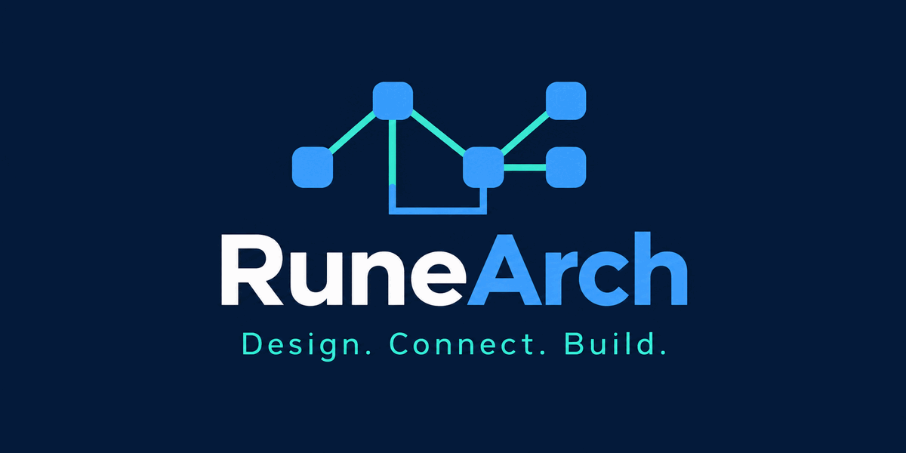

<p align="center">
  
</p>

# RuneArch

RuneArch is a visual planning tool for mapping a software feature across screens, APIs, services, data and user flows. Design on a canvas, then turn that design into specifications and handoff materials. You can plan and wireframe without writing code.

---

## Contents

- [Features](#features)
- [How to use RuneArch](#how-to-use-runearch)
- [A quick tour](#a-quick-tour)
- [Feature scopes: designing on top of an existing system](#feature-scopes-designing-on-top-of-an-existing-system)
- [Exports and the live API](#exports-and-the-live-api)
- [Getting started](#getting-started)
- [Using RuneArch without developer tools](#using-runearch-without-developer-tools)
- [Keyboard shortcuts](#keyboard-shortcuts)
- [Status and limitations](#status-and-limitations)
- [For developers](#for-developers)
- [License](#license)

---

## Features

- **Map a whole system visually.** Add screens and wireframes, components, stores, endpoints, services, jobs, external systems and database tables to one canvas.
- **Connect the pieces.** Show which screens call which endpoints, which services access which tables, and how columns relate through foreign keys.
- **Describe user journeys.** Record named flows through the system and step through them to explain how a feature works.
- **Plan changes safely.** Use feature scopes to label work as existing, new, changed or removed; review impact warnings, conflicts, tasks and migration scripts.
- **Import existing designs.** Bring in database tables from SQL or DBML, API definitions from OpenAPI, or a saved RuneArch project.
- **Export useful handoffs.** Generate OpenAPI, SQL, DBML, Mermaid, starter code, screen descriptions, feature briefs, migrations and canvas images.
- **Keep work recoverable.** Projects autosave and support undo, redo and named checkpoints.

## How to use RuneArch

1. **Create a project** and start with a blank canvas, or import an API or database design you already have.
2. **Add the parts of your idea:** screens, endpoints, services and tables. Double-click an item to add its details; for screens, arrange elements into a wireframe.
3. **Connect related parts** to show how a user action travels through the system. Record important journeys in the **Flows** panel.
4. **For a change to an existing system, create a feature.** Mark what is already there and what the feature adds, changes or removes.
5. **Preview and export** the result from the top bar. Choose the format your team needs to review or build from.

The canvas is intended for visual planning and does not require you to write application code. Some exports, such as generated starter code and SQL migrations, are intended for a developer to review before using.

---

## A quick tour

### 1. Sketch the system

Pick a tool on the left (or press its key, e.g. `S` for a screen, `E` for an endpoint, `T` for a table) and click the canvas to place it. Drag from one node's edge to another to connect them. Group related nodes into **frames** (swimlanes) and add **sticky notes**, text, shapes and arrows wherever explanation helps. `Shift+L` lays out a selection automatically.

### 2. Fill in the details

- **Tables:** columns with types, primary keys, nullability, defaults and notes; indexes; foreign keys picked from the other tables. The SQL tab shows the generated `CREATE TABLE`. Pick the project database (PostgreSQL, MySQL, MariaDB or SQLite) in the *DB Schema* dialog; column types follow it.
- **Endpoints:** method, path (path params like `{orderId}` sync automatically), auth level, query and header params, request body and responses.
- **API models:** reusable request and response shapes in the *API* tab, written by hand or generated from a table in one click.
- **Screens:** a route, plus a wireframe built on a 12-column grid (desktop, tablet or mobile) from headers, inputs, buttons, lists, tables, forms and your own components. Start from a template (login, list, detail, form, dashboard), or generate a form or a list straight from an endpoint.

### 3. Wire up the flows

Connect a screen's **button or form** directly to the endpoint it calls, so a flow can start at the exact element a user clicks. In the *Flows* tab, create a flow, click the connections in order, then step through it with `←` and `→`. Everything outside the flow fades away.

### 4. Share and export

The top bar opens live previews you can copy, download or link to:

- **API Spec:** OpenAPI 3.1 as YAML or JSON.
- **DB Schema:** DBML, Mermaid ER or a SQL script for your database.
- **Code:** starter code generated from the design: Pydantic and Zod schemas from your API models, SQLAlchemy, SQLModel, Drizzle and Prisma models from your tables, and a FastAPI app from your endpoints.
- **Screens:** each screen's layout, actions and the endpoints it calls, as Markdown or JSON.
- **Export:** the whole canvas as an SVG or PNG image (light or dark, optionally with one flow highlighted), a Mermaid flowchart, or a RuneArch JSON file.
- **Import:** bring in tables from SQL DDL or DBML, endpoints and models from an OpenAPI document, or open a RuneArch file. Imports merge into the canvas and can be undone in one step.

---

## Feature scopes: designing on top of an existing system

Most real work isn't greenfield. You add a wishlist to a shop that already has users, products and orders. **Features** let you design that change on the same canvas while keeping track of what already exists.

### Roles

A feature gives each part it touches a role, shown as a badge on the canvas:

| Badge | Meaning | Example |
|---|---|---|
| **EXISTING** | Already built; the feature only uses it | the `users` table the new endpoint reads |
| **NEW** | Added by this feature | the `wishlist_items` table |
| **CHANGED** | Existing, but modified by this feature | `users` gets a `wish_count` column |
| **REMOVED** | Retired by this feature | the old `GET /favorites` endpoint |

### Working on a feature

1. Open the **Features** tab and create a feature, e.g. "Wishlist". You are now *working on* it, and a bar at the bottom of the canvas says so.
2. Design as usual. Everything you **add** is tagged *new*. Everything you **edit** is tagged *changed*, and RuneArch quietly keeps a copy of how it looked before your first edit.
3. **Right-click** any node or connection to mark it as *existing* (used as is) or *removed*.
4. Click the feature to **highlight** it: everything else fades, changed tables show `+` and `~` next to added and changed columns (dropped ones are struck through), and screens mark new and changed elements.

### What the feature tells you

Each item in the panel can carry a note ("why do we need this column?"). Changed items list their exact changes, e.g. `~ Column email: type text → citext`. You can **revert** a single change or the whole item.

The feature also warns you, without ever blocking anything, about:

- a new NOT NULL column without a default, which means existing rows need a **backfill**;
- **breaking API changes**: a removed field, tightened auth, a new required param;
- the **API version** your changes call for (major, minor or patch), with a one-click *Apply*;
- new endpoints that nothing calls, and new tables that nothing reads or writes;
- flows that pass through parts the feature doesn't list, with a one-click *Add as existing*;
- other open features that change the same parts (**conflicts**), or whose additions this one **depends on**.

### Hand it off

Each feature exports its own:

- **Brief** (Markdown or JSON): the goal, acceptance criteria, open questions, the flows written out, and every table, endpoint, model and screen grouped *new / changed / removed / existing*, each with its changes, notes and DDL. It's written to be handed to a developer or an AI coding assistant as the full context of the work.
- **Task list:** a checklist per lane (database, backend, frontend), e.g. "Add column `wish_count` to table `users` (NOT NULL without a default: backfill existing rows)".
- **Migration** (up and down) for PostgreSQL, MySQL/MariaDB or SQLite: new tables, added and changed columns, indexes, foreign keys and dropped tables, in the right order.

The project-wide exports (OpenAPI, DB schema, code, canvas image) can also be scoped to a single feature, with everything marked by role, or to the project without what unshipped features add.

### Ship or discard

When the work is done, **Ship** the feature: a checkpoint is saved first, the parts it removed are deleted for good, and its additions and changes become the plain project. Or **Discard** it to put the canvas back exactly as it was before the feature. Both are one undo step.

---

## Exports and the live API

Every export is also served live by the API, so other tools can read the current design directly. Replace `:id` with the project id from the browser's address bar. The API serves the last **saved** version, which the editor writes a moment after each change.

| URL | What you get |
|---|---|
| `GET /api/projects/:id/openapi.json` · `.yaml` | OpenAPI 3.1 spec |
| `GET /api/projects/:id/schema.dbml` · `.mmd` · `.sql` | Database schema (`?dialect=postgresql\|mysql\|mariadb\|sqlite` for SQL) |
| `GET /api/projects/:id/code/:target` | Generated code; `:target` is `pydantic`, `zod`, `sqlalchemy`, `sqlmodel`, `drizzle`, `prisma` or `fastapi` |
| `GET /api/projects/:id/screens.md` · `.json` | Screen descriptions |
| `GET /api/projects/:id/screens/:screenId/wireframe.svg` | One screen's wireframe |
| `GET /api/projects/:id/canvas.svg` · `.mmd` · `.json` | The canvas as an image, a Mermaid flowchart or a RuneArch file (`?theme=dark`, `?flow=<flowId>`) |
| `GET /api/projects/:id/features/:featureId/brief.md` | A feature's brief (also `brief.json`, `tasks.md`, `migration.up.sql`, `migration.down.sql`) |

The OpenAPI, schema, code and canvas exports also accept `?feature=<featureId>` (one feature, marked by role) or `?unshipped=exclude` (the project without unshipped additions). For a feature's OpenAPI spec, `&only=changes` keeps just the endpoints it adds, changes or removes. Each preview dialog has a **Copy live URL** button that builds these links for you.

---

## Getting started

### Option A: Docker (no Node.js or pnpm required)

You need [Docker Desktop](https://docs.docker.com/get-started/get-docker/) running. This option does not require Node.js, pnpm or Git:

1. [Download the RuneArch source ZIP](https://github.com/FinnyChSt/RuneArch/archive/refs/heads/main.zip) and extract it.
2. Open a terminal in the extracted repository folder.
3. Run:

   ```bash
   docker compose --profile app up -d --build
   ```

4. Open <http://localhost:8080> in your browser. The database is initialized automatically; no account or password is needed for a local install.

Stop RuneArch with `docker compose --profile app down`. Your projects stay in the `pgdata` volume.

### Option B: run it for development

You need **Node.js 24**, **pnpm 11** and **Docker** (for PostgreSQL).

```bash
git clone https://github.com/FinnyChSt/RuneArch.git
cd RuneArch
pnpm install                                   # also builds the shared package
docker compose up -d                           # PostgreSQL only
cp apps/api/.env.example apps/api/.env
pnpm --filter api db:migrate                   # create the tables
pnpm --filter api db:seed                      # create the local user
pnpm dev                                       # web on :5173, API on :3000
```

Open <http://localhost:5173> and create your first project.

---

## Using RuneArch without developer tools

You can use the visual canvas without coding. To run RuneArch yourself today, you still need Docker Desktop and must paste the one Docker command in Option A above; this repository does not currently provide a hosted demo or a one-click installer.

If someone on your team runs a private instance, you can open it in a browser without installing development tools. However, RuneArch does not have real sign-in yet: everyone using an instance shares the same local account and projects. Keep it on your own computer or a trusted private network, and do not put sensitive information into an instance shared with other people.

**To make RuneArch easier for non-developers**, the most helpful next steps would be a preloaded example project with a guided first-use walkthrough, followed by an authenticated hosted demo or a desktop installer. Those are product improvements, not features available in the current version.

---

## Keyboard shortcuts

Shortcuts work while the canvas has focus (not while typing or while a dialog is open).

| Key | Action | Key | Action |
|---|---|---|---|
| `V` | Select | `H` | Pan |
| `S` | Screen | `C` | Component |
| `E` | Endpoint | `J` | Job / event |
| `T` | Table | `F` | Frame / swimlane |
| `R` | Rectangle | `O` | Ellipse |
| `A` | Arrow | `X` | Text |
| `N` | Sticky note | `P` | Pen |
| `Cmd/Ctrl+Z` | Undo | `Cmd/Ctrl+Shift+Z` or `Cmd/Ctrl+Y` | Redo |
| `Cmd/Ctrl+D` | Duplicate | `Delete` / `Backspace` | Remove selection |
| `Cmd/Ctrl+G` | Group into a frame | `Cmd/Ctrl+Shift+G` | Ungroup |
| `Shift+L` | Auto-layout the selection | `Shift+1` | Fit everything into view |
| `Enter` | Edit the selected node | `←` `→` | Step through the active flow |
| `Esc` | Stop recording, leave a flow, or clear the tool and selection | | |

---

## Status and limitations

RuneArch is an early, working product. Before using it beyond your own machine, know that:

- **There is no real sign-in yet.** Everyone using an instance acts as the same local user. Run it locally or on a private network only; don't expose it to the internet yet. Real authentication is planned.
- **One person at a time.** If two tabs edit the same project, the later save gets a conflict notice (reload the latest version or overwrite it) instead of a merge. Real-time collaboration is planned.
- **Planned next:** using an imported system as the starting point for features, progress tracking per feature item, and a mock server.

---

## For developers

### Stack

A pnpm monorepo in TypeScript:

| Package | What it is |
|---|---|
| `apps/web` | React + Vite, the canvas built on [React Flow](https://reactflow.dev), state in Zustand with undo history, Tailwind styling |
| `apps/api` | NestJS with Drizzle ORM on PostgreSQL; stores each project's canvas as one validated JSON document with optimistic locking |
| `packages/shared` | Zod schemas for the whole document (the single source of truth for both apps) and every generator and importer: OpenAPI, SQL, DBML, Mermaid, SVG, code, briefs and migrations, as pure functions |

[`ARCHITECTURE.md`](ARCHITECTURE.md) describes the design, the data model, the save and conflict model and the key trade-offs. [`AGENT.md`](AGENT.md) is the hands-on guide to working in the codebase: rules, conventions and recipes for common changes.

### Commands

```bash
pnpm dev            # web + API with hot reload
pnpm typecheck      # all packages
pnpm lint           # oxlint
pnpm format         # prettier (pnpm format:check to verify only)
pnpm test           # unit tests + API end-to-end tests (needs PostgreSQL running; uses a separate test database)
pnpm e2e            # browser tests with Playwright: starts its own API + web app on a fresh database (needs PostgreSQL)
pnpm --filter api db:generate   # new migration after changing apps/api/src/db/schema.ts
```

`docker compose --profile app watch` runs the full stack in Docker and rebuilds a service when its code changes.

### Contributing

Issues and pull requests are welcome. Please keep changes focused, add tests for new behavior, and run `pnpm typecheck`, `pnpm lint`, `pnpm test` and `pnpm e2e` before opening a pull request. CI runs the first three on every pull request; the Playwright tests run locally only. Domain types belong in `packages/shared`; the web app and the API import them rather than redefining them.

---

## License

[Apache License 2.0](LICENSE)
